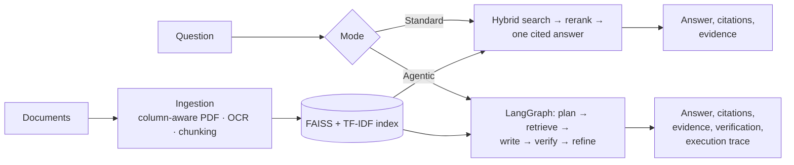

# RAGBase

**Local-first document Q&A that compares Standard and Agentic RAG — with inspectable citations, a bounded LangGraph agent, and an evaluation that reports where each approach falls short.**

[](https://github.com/Namantyagi2727/ragbase/actions/workflows/ci.yml)
[](https://python.org)
[](https://streamlit.io)
[](https://langchain-ai.github.io/langgraph/)
[](https://ollama.com)
[](LICENSE)

RAGBase answers questions about your own documents and shows its work: every
answer cites numbered passages you can open, and the optional agent mode
shows how it planned, searched and checked its claims. It runs entirely on
your machine with [Ollama](https://ollama.com) by default.

## Two ways to see it

| | Public showcase | Full local app |
|---|---|---|
| Where | **https://ragbase-showcase.streamlit.app/** | Your machine (`streamlit run app.py`) |
| Answers | **Recorded runs** of the real pipeline, replayed with provenance. **No live model inference** | Live answers from your local Ollama model |
| Documents | A curated synthetic corpus (fictional company) | Your own uploads, indexed per session |
| Questions | Ten curated questions; no free-text input | Anything you ask |

The showcase exists so anyone can inspect real outputs — citations, agent
traces, verification results and known failures — without installing
anything. To try your own documents and questions, run it locally.


## Engineering highlights

- **Hybrid retrieval** — FAISS semantic search and TF-IDF keyword search
  fused with reciprocal-rank fusion, then cross-encoder reranking.
- **Inspectable citations** — answers cite numbered evidence (`[1]`, `[2, 3]`);
  IDs are validated against the retrieved passages, and cited passages are
  shown separately from those retrieved but not used.
- **Agentic RAG with LangGraph** — a bounded workflow that plans sub-queries,
  selects documents for comparisons, verifies claims against their
  citations and refines at most once, with a structured execution trace.
- **Honest verification wording** — a citation or a verifier verdict is
  presented as evidence about an answer, never as proof that it is correct.
- **Evaluation framework** — a human-reviewed benchmark comparing the
  original code, Standard RAG and Agentic RAG, with versioned labels and
  scoring ([methodology](#evaluation)).
- **CI/CD** — linting, unit and integration tests on every pull request, a
  manually triggered live-inference workflow, and a pinned deployment for
  the public showcase.

## Features

| | |
|---|---|
| **Standard RAG** | One hybrid search, one model call, numbered citations checked for validity |
| **Agentic RAG** | LangGraph workflow: plan → retrieve → write → verify → (refine) → finish, bounded by time, revision and search limits |
| **Comparison questions** | Documents named in the question (or by the planner) are searched separately; otherwise a relevance search chooses them |
| **Claim verification** | Deterministic checks (citation IDs, numbers present in the cited text) plus per-claim model verdicts; results shown as checked, partly checked or not checked |
| **Multi-format ingestion** | PDF (with column-aware extraction for two-column pages), DOCX, TXT, CSV, Excel, and images via OCR |
| **Tabular Q&A** | Questions over CSV/Excel answered with allowlisted dataframe operations; model output is never executed as code |
| **Inference backends** | Direct local Ollama (default) or an optional [Prism](docs/PRISM.md) gateway with fail-closed provider verification |
| **Session-isolated uploads** | Each browser session indexes its uploads in its own temporary workspace |


## How it works



Detailed diagrams — ingestion, retrieval, the agent graph, verification
states, the Prism gateway and the local/showcase split — are in
**[docs/ARCHITECTURE.md](docs/ARCHITECTURE.md)**.

<p>
  
  
</p>

*Left: the agent's execution summary for a comparison question (recorded run) — it searched exactly the two policy versions, and its verifier flagged two figures whose citations pointed at the wrong passage. Right: the source-document viewer.*

## Quickstart (local, Python 3.12)

Prerequisites: **Python 3.12** (the tested version), **[Ollama](https://ollama.com)**, and optionally **Tesseract OCR** (`brew install tesseract` or `apt install tesseract-ocr`) — needed only for images and scanned PDF pages.

```bash
git clone https://github.com/Namantyagi2727/ragbase.git
cd ragbase
python3.12 -m venv .venv
source .venv/bin/activate          # Windows: .venv\Scripts\activate
pip install -r requirements.txt -c constraints.txt
ollama pull llama3.2               # the default model; Ollama must be running
streamlit run app.py
```

Open http://localhost:8501, upload documents, click **Build Index**, choose
**Standard RAG** or **Agentic RAG**, and ask a question. The first run
downloads the embedding and reranking models from Hugging Face.

`constraints.txt` pins every dependency version used in CI, so a fresh
install matches what was tested. To preview the public showcase locally
(only Streamlit needed): `pip install -r showcase/requirements.txt`, then
`streamlit run showcase/streamlit_app.py`.

### Development

```bash
pip install -r requirements-dev.txt -c constraints.txt
ruff check .
pytest tests/unit                  # no models needed
pytest tests/integration           # real embedding models; live Ollama/Prism tests skip if unavailable
```

## Configuration

Defaults live in [`config.py`](config.py); model, chunking and retrieval
settings can also be changed in the app's sidebar.

| Setting | Environment variable | Default |
|---|---|---|
| Ollama model | `OLLAMA_MODEL` | `llama3.2` |
| Ollama server | `OLLAMA_BASE_URL` | `http://localhost:11434` |
| Backend | `RAGBASE_LLM_BACKEND` | `ollama` (or `prism`, see [PRISM.md](docs/PRISM.md)) |
| Embedding model | `RAGBASE_EMBED_MODEL` | `all-MiniLM-L6-v2` |
| Agent refinement rounds / time budget | `RAGBASE_AGENT_MAX_REVISIONS` / `RAGBASE_AGENT_TIME_BUDGET_S` | `1` / `180` |
| Upload limits | `RAGBASE_MAX_UPLOAD_MB` / `RAGBASE_MAX_UPLOAD_FILES` | `50` / `50` |
| Question length limit | `RAGBASE_MAX_QUESTION_CHARS` | `2000` |
| Tabular Q&A | `RAGBASE_TABULAR_QA` | on |

Chunk size (512), overlap (64), top-k (5), the fused candidate pool (20) and
the reranker (`cross-encoder/ms-marco-MiniLM-L-6-v2`) are set in `config.py`.

## Evaluation

RAGBase was evaluated on **42 human-reviewed questions** over a synthetic
eight-document corpus, comparing three systems — the original pre-upgrade
code, Standard RAG and Agentic RAG — with the same local model
(`llama3.2` 3B), retrieval configuration and seeds, three repeats each.

What was measured, separately:

- **Correctness as a keyword proxy** — the answer contains the reviewed
  required facts and no known-wrong statement. This is not human-verified
  semantic accuracy.
- **Abstention** — declining unanswerable questions, and not declining answerable ones.
- **Citations** — whether cited IDs exist, and separately whether the cited
  passages contain the expected evidence.
- **Retrieval and cost** — expected passages found; model calls, tokens and latency.
- **Verifier challenge set**, **tabular security suite**, and a calibrated
  local **LLM judge** used as supporting evidence only.

Findings: under the tested configuration **Standard RAG performed best
overall**, at a fraction of the agent's model calls and latency. The
benchmark exposed two genuine agent defects — comparison questions searched
documents in alphabetical order, and partly hedged answers were treated as
refusals — which were fixed and re-measured in separately labelled runs.
Label and scoring changes are versioned and reported separately from
application changes ([change log](docs/EVALUATION_CHANGELOG.md)). Detailed
results will be published here after review.

## Security and privacy

- **Local by default** — with the Ollama backend, documents and questions
  never leave your machine. Streamlit usage statistics are disabled.
- **Optional Prism gateway** — offered only when configured. Prism's
  guardrails can block prompts, and it caches responses for an hour, so
  document-derived text is held there; RAGBase rejects answers from
  providers outside an allowlist (fail closed). See [PRISM.md](docs/PRISM.md).
- **Untrusted content** — document text is treated as data in every prompt;
  model answers are rendered as escaped text (not Markdown), so injected
  content cannot load remote images or disguise links.
- **No code execution** — spreadsheet questions use allowlisted operations.
- **Uploads** — safe file names, size and count limits, per-session workspaces.
- **Public showcase** — read-only, recorded runs, no inference or tabular
  code loaded; details and residual risks in [DEPLOYMENT.md](docs/DEPLOYMENT.md).

## Known limitations

- Standard RAG outperformed Agentic RAG overall on the benchmark; the agent
  costs more model calls and time.
- Multi-document synthesis, false-premise questions and some two-step
  questions remain weak in both modes.
- The claim verifier is a small model: it rejects some supported claims and
  accepts some incorrect ones. Citations show provenance, not correctness.
- Tabular Q&A answers most but not all questions in its test suite.
- The evaluation uses one small local model, one machine and 42 synthetic
  questions; the keyword proxy and the LLM judge are both fallible.
- Not a production service: no authentication, multi-user deployment or
  persistent storage beyond the local index.

## Repository guide

```
app.py                  Streamlit entry point (local app or showcase)
ui/                     Local app, showcase, answer/citation/trace rendering, theme
agent/                  LangGraph workflow, document selection, claim verifier
retriever.py            Hybrid retrieval, reranking, Standard RAG chain
ingest.py               Loading, column-aware PDF extraction, OCR, chunking, indexing
citations.py            Evidence IDs, citation validation, abstention detection
tabular.py              Allowlisted tabular Q&A
llm/                    Ollama and Prism clients
evals/                  Benchmark corpus, reviewed labels, harness, metrics, reports
showcase/               Public showcase entry point, recorded runs, curated questions
scripts/                Showcase recorder, Prism helpers
tests/                  Unit and integration tests
docs/                   Architecture, deployment, evaluation change log, Prism, demo, development log
```

| Document | Contents |
|---|---|
| [docs/ARCHITECTURE.md](docs/ARCHITECTURE.md) | Diagrams of every component |
| [docs/DEMO.md](docs/DEMO.md) | A short guided walkthrough |
| [docs/DEPLOYMENT.md](docs/DEPLOYMENT.md) | Showcase deployment, measurements, security checklist |
| [docs/EVALUATION_CHANGELOG.md](docs/EVALUATION_CHANGELOG.md) | Label, scoring and output versions |
| [docs/PRISM.md](docs/PRISM.md) | Optional gateway backend and its privacy behaviour |
| [docs/DEVELOPMENT_LOG.md](docs/DEVELOPMENT_LOG.md) | Engineering log of each phase and decision |
| [BENCHMARKS.md](BENCHMARKS.md) | Historical latency benchmark (October 2026, earlier code) |

## Stack

Python 3.12 · [LangChain](https://python.langchain.com) · [LangGraph](https://langchain-ai.github.io/langgraph/) ·
[FAISS](https://github.com/facebookresearch/faiss) · [scikit-learn](https://scikit-learn.org) TF-IDF ·
[sentence-transformers](https://sbert.net) embeddings and cross-encoder ·
[Ollama](https://ollama.com) · [Streamlit](https://streamlit.io) ·
[pdfplumber](https://github.com/jsvine/pdfplumber) · [Tesseract](https://github.com/tesseract-ocr/tesseract) ·
pydantic · pytest · ruff · GitHub Actions

## License

MIT — see [LICENSE](LICENSE).
