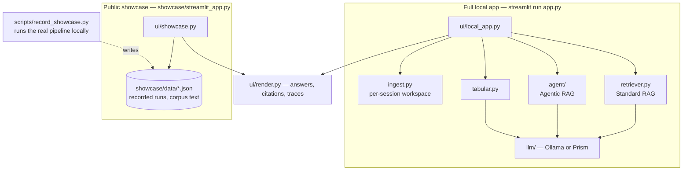
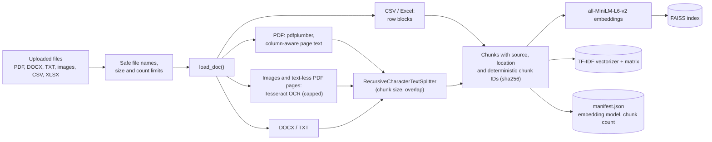
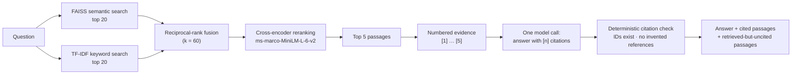
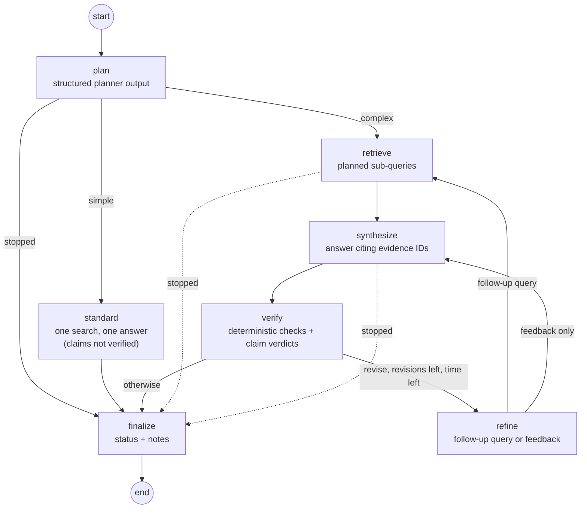
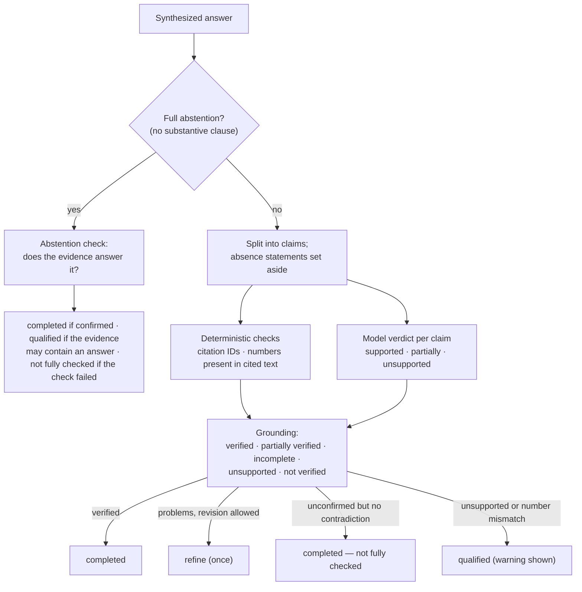
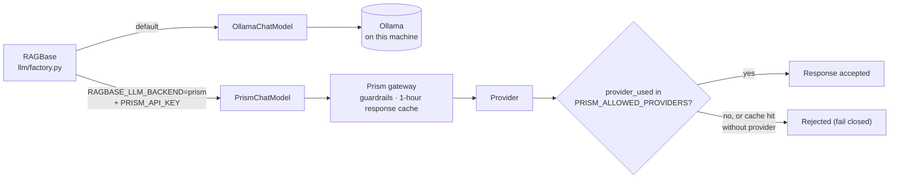
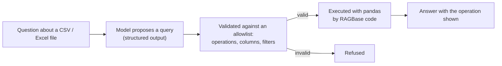

# Architecture

How RAGBase works, drawn from the code. Module names are given so each
diagram can be checked against the source.

- [Local application and public showcase](#local-application-and-public-showcase)
- [Ingestion and indexing](#ingestion-and-indexing)
- [Hybrid retrieval and evidence citations (Standard RAG)](#hybrid-retrieval-and-evidence-citations-standard-rag)
- [Agentic RAG: the LangGraph workflow](#agentic-rag-the-langgraph-workflow)
- [Claim verification and bounded refinement](#claim-verification-and-bounded-refinement)
- [Inference backends: Ollama and the optional Prism gateway](#inference-backends-ollama-and-the-optional-prism-gateway)
- [Tabular questions](#tabular-questions)

## Local application and public showcase

Two Streamlit experiences share the same rendering code and stylesheet but
not the same capabilities.

- The showcase imports no ingestion, retrieval-model, agent, LLM or tabular
  code and offers no text input or upload widget; it replays answers that
  `scripts/record_showcase.py` recorded from the real pipeline, with
  provenance. It is deployed from the `showcase-deploy` branch
  ([deployment details](DEPLOYMENT.md)).
- `app.py` is a thin entry point that loads one experience or the other.

## Ingestion and indexing

- Two-column PDF pages are detected conservatively and read column by
  column, so side-by-side rules (for example, over-21 and under-21 limits)
  are not interleaved.
- In the local app the index is built in a temporary workspace for the
  browser session (`ui/uploads.py`).

## Hybrid retrieval and evidence citations (Standard RAG)

- Citation **validity** (the IDs exist) is checked for every answer. It does
  not show that the cited passage supports the claim; Standard RAG performs
  no claim verification and the interface says so.
- Evidence text is passed to the model as untrusted data.

## Agentic RAG: the LangGraph workflow

- **Bounds:** at most one refinement round (default), a time budget, at most
  three sub-queries, and at most five documents per comparison. A failed or
  timed-out step goes straight to `finalize`.
- **Comparison questions:** `agent/sources.py` searches the documents named
  in the question (or by the planner); otherwise one relevance search picks
  the documents. Passages are interleaved by source, and any limitation
  (fewer than two documents found, or more than the limit) is recorded.
- **Tools:** read-only `hybrid_search` and `list_documents`. Unknown source
  names are dropped, so model output cannot widen the search.
- Every step emits a structured trace event (route, sub-queries, searches,
  documents chosen, verification counts), which the interface shows. The
  planner's free-text rationale is not displayed.

## Claim verification and bounded refinement

- A failed verifier call is never treated as verification; the answer is
  reported as not fully checked.
- Statements that information is missing are not verified as facts; the
  answer carries a note that they are based on the passages retrieved.
- The interface describes a "verified" result as an automated check by a
  language model, not a guarantee of correctness.

## Inference backends: Ollama and the optional Prism gateway

- Direct Ollama is the default and keeps all text on the machine.
- Prism is offered only when configured. Its guardrails can block prompts,
  and it caches responses for an hour (so document-derived text is held in
  its cache); repeated identical requests can be rejected as cache hits. See
  [PRISM.md](PRISM.md).

## Tabular questions

Model output is never executed as code. Not available in the public showcase.
