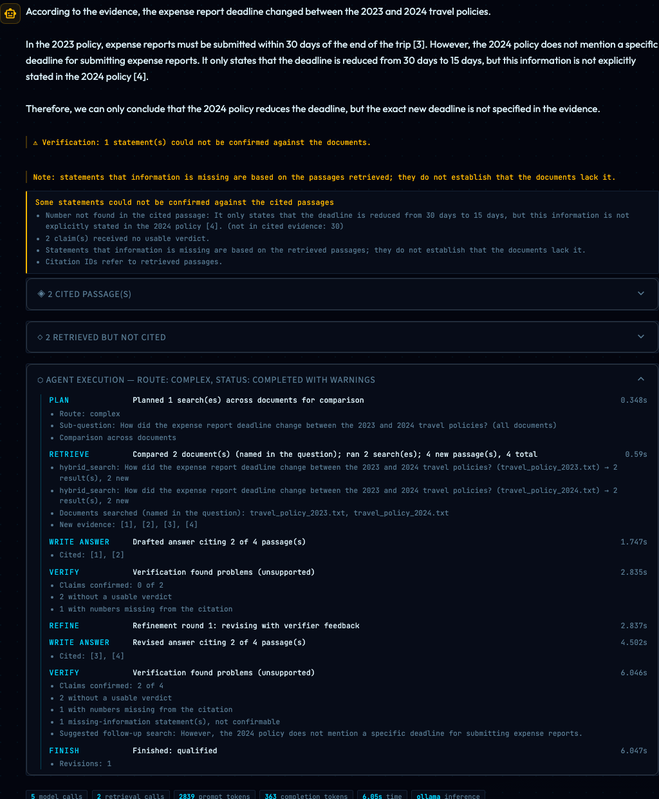

# Demo walkthrough (about 2½ minutes)

A guided tour for someone seeing RAGBase for the first time. Steps are marked:

- **[Recorded]** — the public showcase at https://ragbase-showcase.streamlit.app/.
  It replays genuine recorded runs of the pipeline; it runs no model.
- **[Live]** — the full app on your own machine with Ollama.

## 1. The problem (0:00–0:20) [Recorded]

Open the showcase. RAGBase answers questions about an organisation's
documents and shows exactly which passages each answer came from, so a
reader can check it. The notice at the top makes clear these are recorded
runs, not live inference.

## 2. Standard vs Agentic (0:20–0:50) [Recorded]

Choose **A direct policy lookup**. Both answers appear side by side:

- **Standard RAG** — one hybrid search, one model call. Its status box says
  "Not checked": Standard RAG does not verify claims.
- **Agentic RAG** — a LangGraph workflow that plans, retrieves, writes an
  answer and checks each claim against its citation. For this question the
  planner chose the complex route, so the claim was checked: it was judged
  supported, with a note that this is an automated check, not a guarantee.

Not every Agentic answer is claim-checked. When the planner judges a
question simple, the agent answers like Standard RAG and the status says
"Not checked — simple route" (for example **The two-column page
regression** and **Combining two documents**).


*The screenshot shows a different curated question, "Comparing two policy versions": both answers give the right change, and the agent's check flags that its single citation covers only the 2024 figure.*

## 3. Sources, citations and verification (0:50–1:20) [Recorded]

Open **cited passages**: every `[n]` in the answer maps to a passage, with its
document and location. **Retrieved but not cited** shows what was found but
not used. Citations show provenance; they are never presented as proof.

## 4. A multi-document comparison (1:20–1:50) [Recorded]

Choose **A rule that changed in two ways** and open **Agent execution**. The
agent searched exactly the 2023 and 2024 travel policies (documents named in
the question). Its citation-grounded checks confirmed two of three claims and
flagged two figures that do not appear in the passages they cite — the
citations point at the wrong passage of the right document — so the answer
carries a warning. The Standard answer gets the thresholds right but wrongly says
approval above 250 dollars was removed.


## 5. A known limitation (1:50–2:15) [Recorded]

Choose **A false premise**. Both modes accept the question's false premise
("the 2024 policy reduced the allowance from $45 to $60"); the curator's note
says so. The benchmark measured failures like this, and it also exposed an
agent bug — comparison questions used to search documents in alphabetical
order — which was fixed and re-measured.

## 6. Run it live (2:15–2:40) [Live]

```bash
pip install -r requirements.txt -c constraints.txt
ollama pull llama3.2
streamlit run app.py
```

Upload documents, click **Build Index**, choose **Standard RAG** or **Agentic
RAG**, and ask anything. With the default Ollama backend everything stays on
your machine.


A live Agentic run can also go wrong in ways the system flags. In this local
run the answer contradicts itself about the 2024 deadline; the verifier
could not confirm a statement, the status is *completed with warnings*, and
the trace shows both policies were searched:



## Ground rules for presenting

- Say "recorded" for anything shown on the public showcase.
- Don't describe Agentic RAG as better overall: on the benchmark, Standard
  RAG performed best at a fraction of the cost.
- Describe correctness figures, when published, as a keyword proxy.
